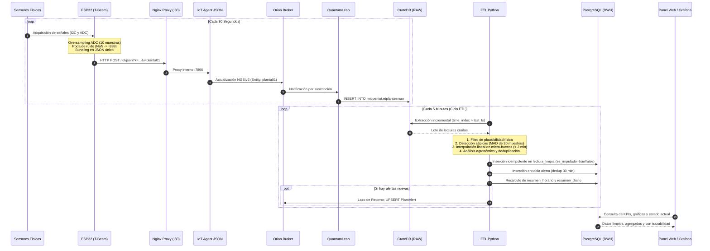

# AgroSense · Sistema Inteligente de Monitoreo y Control Agrícola

Plataforma IoT de agricultura de precisión basada en el estándar europeo **FIWARE (NGSI v2)**, diseñada para el monitoreo en tiempo real, análisis histórico, detección de anomalías y diagnóstico con Inteligencia Artificial generativa (**Google Gemini**) del estado de cultivos.

El sistema integra un dispositivo en el extremo (**LilyGO TTGO T-Beam ESP32**) con sensores ambientales y de suelo, una infraestructura en la nube (**AWS EC2 con IP Elástica**), una cadena analítica de datos crudos (**QuantumLeap + CrateDB**), un pipeline **ETL** autónomo con **imputación e interpolación lineal controlada**, un **Data Warehouse relacional (PostgreSQL)**, una **API en FastAPI con IA contextual**, un **Panel de Control Web reactivo en React/Vite** y un centro de observabilidad en **Grafana**.

---

## 1. Arquitectura General del Sistema


## 2. Diagrama de Secuencia del Flujo de Datos



---

## 3. Especificaciones de Infraestructura Cloud y Seguridad

### 3.1 Instancia de Servidor (AWS EC2)
* **Proveedor:** Amazon Web Services (AWS Academy / Learner Lab).
* **Región:** `us-east-1` (N. Virginia).
* **Tipo de Instancia:** `t3.large` (2 vCPU, 8 GiB RAM, 24 GB Disco gp3).
* **Sistema Operativo:** Ubuntu Server 24.04 / 26.04 LTS (Canonical).
* **Dirección IP Elástica (Fija):** `32.193.138.160` (Asociada de forma permanente a la interfaz de red para evitar que la IP pública cambie tras reinicios del laboratorio).
* **Motor de Contenedores:** Docker 29.1.3 + Docker Compose v2.40.3.

### 3.2 Firewall y Reglas del Grupo de Seguridad (AWS Security Group)

| Puerto | Protocolo | Tipo / Servicio | Origen (CIDR) | Justificación Técnica |
|---|---|---|---|---|
| **22** | TCP | SSH | Tu IP / `0.0.0.0/0` | Acceso seguro a la terminal remota y despliegue por `scp`/`ssh`. |
| **80** | TCP | HTTP (Nginx) | `0.0.0.0/0` | **Punto de entrada único:** Sirve el Panel Web React, enruta `/api/*` hacia FastAPI y recibe la telemetría del sensor en `/iot/json`. |
| **1036** | TCP | Orion Broker | `0.0.0.0/0` | API NGSIv2 de Orion (mapeado desde el 1026 interno para evitar escaneos automatizados). |
| **3000** | TCP | Grafana | `0.0.0.0/0` | Dashboards estadísticos y de telemetría técnica para administración y jurados. |
| **4200** | TCP | CrateDB UI | `0.0.0.0/0` | Consola administrativa de la base de datos cruda de series de tiempo (protegida por clave). |
| **7896** | TCP | IoT Agent | *Interno* (Cerrado a Internet) | No se expone públicamente; el tráfico del microcontrolador entra por el puerto 80 vía Nginx (`/iot/json`). |
| **5432** | TCP | PostgreSQL DWH | *Interno* (`127.0.0.1`) | Confinado a la red interna de Docker (`agroiot-net`) para evitar accesos no autorizados a la base analítica. |
| **27017** | TCP | MongoDB | *Interno* (`127.0.0.1`) | Base de datos de estado de Orion Context Broker, aislada dentro de la red privada de Docker. |

---

## 4. Stack Tecnológico Completo

| Área | Tecnología | Versión / Detalle | Justificación |
|---|---|---|---|
| **Microcontrolador** | LilyGO TTGO T-Beam | ESP32-D0WDQ6 V1.1 (240MHz, Wi-Fi 2.4GHz) | Potencia de cálculo para Edge Computing, soporte I2C/ADC y conectividad Wi-Fi nativa. |
| **Entorno Firmware** | PlatformIO | Core v6 / Arduino Framework | Compilación determinista, control de librerías y gestión de dependencias embebidas. |
| **Gateway / Ingesta** | FIWARE IoT Agent JSON | Image: `fiware/iotagent-json:latest` | Estándar de interoperabilidad europea para transformar JSON simple a entidades NGSIv2. |
| **Context Broker** | FIWARE Orion | Image: `fiware/orion:4.5.0` | Gestor de contexto Publish/Subscribe que mantiene el estado digital vivo del cultivo. |
| **Suscripción Time-Series** | QuantumLeap | Image: `orchestracities/quantumleap:latest` | Captura cambios de estado en Orion y los transforma en series temporales hacia CrateDB. |
| **Base de Datos Cruda (RAW)** | CrateDB | Image: `crate:5.5` | Motor SQL distribuido sobre Lucene optimizado para inserciones masivas de series de tiempo. |
| **ETL / Procesamiento** | Python 3.12 | Image custom `agroiot-etl` | Pipeline modular de extracción, limpieza (MAD), interpolación y rollups agregados. |
| **Data Warehouse (DWH)** | PostgreSQL | Image: `postgres:16-alpine` | Base de datos relacional analítica con soporte para cálculos estadísticos exactos y persistencia ACID. |
| **API Backend** | FastAPI + Uvicorn | Python 3.12 (`agroiot-api`) | API asíncrona de alto rendimiento, autenticación segura HMAC y conector con LLM. |
| **Inteligencia Artificial** | Google Gemini | `gemini-3.8-flash` (Interactions REST API) | Diagnóstico botánico en tiempo real usando como contexto las métricas y alertas del DWH. |
| **Frontend Web** | React 19 + Vite | Tailwind CSS + Lucide Icons + Recharts | Interfaz moderna, reactiva, accesible y optimizada tanto para escritorio como móviles. |
| **Proxy Inverso / Web Server**| Nginx | Image: `nginx:alpine` | Terminación HTTP, enrutamiento reverso unificado y entrega estática de la SPA. |
| **Observabilidad** | Grafana | Image: `grafana/grafana:11.3.0` | Tableros visuales automáticos aprovisionados por código (Infrastructure as Code). |

---

## 5. Especificaciones del End Device y Sensores

### 5.1 Hardware Utilizado
1. **Microcontrolador:** LilyGO TTGO T-Beam V1.1 (ESP32).
2. **Sensor de Temperatura y Humedad del Aire:** ClosedCube **HDC1080** (Comunicación digital I2C, dirección `0x40`).
   * Rango de temperatura: $-40^\circ\text{C}$ a $125^\circ\text{C}$ (Precisión $\pm 0.2^\circ\text{C}$).
   * Rango de humedad: $0\%$ a $100\%$ RH (Precisión $\pm 2\%$).
3. **Sensor de Luz Ambiental:** CJMCU-3216 (**AP3216**, Comunicación digital I2C, dirección `0x1E`).
   * Rango de luz: $0$ a $65\,535$ lux con calibración hasta $120\,000$ lux.
4. **Higrómetro de Suelo:** Sonda capacitiva/resistiva conectada a comparador **LM393**.
   * Salida analógica (AO) leída mediante el conversor ADC1 del ESP32.

### 5.2 Tabla de Conexiones Físicas y Cableado (Pinout)

| Sensor / Módulo | Pin del Sensor | Pin en TTGO T-Beam | Color de Cable | Descripción de la Señal |
|---|---|---|---|---|
| **HDC1080** | GND | GND | Negro | Tierra común |
| **HDC1080** | 3.3V (VCC) | 3.3V | Blanco (1) | Alimentación lógica 3.3V |
| **HDC1080** | SDA | GPIO 21 | Gris / Blanco (2) | Línea de datos I2C |
| **HDC1080** | SCL | GPIO 22 | Morado | Línea de reloj I2C |
| **AP3216 (CJMCU)**| GND | GND | Negro | Tierra común compartida |
| **AP3216 (CJMCU)**| VCC | 3.3V | Blanco | Alimentación lógica 3.3V |
| **AP3216 (CJMCU)**| SDA | GPIO 21 | Blanco | Línea de datos I2C compartida |
| **AP3216 (CJMCU)**| SCL | GPIO 22 | Morado | Línea de reloj I2C compartida |
| **Humedad Suelo** | GND | GND | Verde | Tierra común |
| **Humedad Suelo** | VCC | 3.3V | Azul | Alimentación 3.3V |
| **Humedad Suelo** | AO (Analógico) | **GPIO 39 (VN)** | Naranja | Lectura de voltaje ADC1 (Atenuación 11 dB) |
| **Humedad Suelo** | DO (Digital) | GPIO 4 | Amarillo | Umbral digital (opcional / no usado) |

### 5.3 Procesamiento al Borde (Edge Computing) en `main.cpp`
* **Multisensor Bundling:** Agrupa las variables de todos los sensores en una sola carga HTTP para reducir drásticamente el consumo energético del radio Wi-Fi.
* **Oversampling y Agregación ADC:** El conversor ADC del ESP32 presenta no linealidades y ruido térmico. Se implementó una rutina en `leerSueloRaw()` que toma **10 muestras consecutivas** con retardo de 5 ms y calcula su media.
* **Poda de Ruido (Noise Pruning):** Si una lectura I2C falla o devuelve `NaN`, se poda y se sustituye por `-999.0f` (centinela que activa alertas en el ETL en lugar de corromper la serie). Los valores analógicos se acotan con `constrain(..., 0, 100)`.
* **Aislamiento de Fallas de Hardware:** En el `setup()`, antes de iniciar la librería I2C, el firmware configura temporalmente los pines 21 y 22 con `INPUT_PULLUP` digital. Si detecta que alguna línea está pegada a tierra (corto por cable invertido), omite el escaneo I2C evitando que la placa quede congelada indefinidamente.
* **Chirp Telemetry:** Emisión periódica tipo latido cada 30 segundos (`INTERVALO_LECTURA_MS = 30000`).

---

## 6. Proceso de ETL y Tratamiento Analítico de Datos

El ETL ([`app/etl/etl.py`](file:///C:/Users/Usuario/Desktop/AgroIoT/app/etl/etl.py)) corre en un ciclo continuo cada 5 minutos (o según `ETL_INTERVAL_SECONDS`):

### 6.1 Extracción Incremental
Consulta a CrateDB con `WHERE time_index > last_saved_ts ORDER BY time_index LIMIT 5000`. Nunca reprocesa el histórico completo, manteniendo el tiempo de ejecución en milisegundos.

### 6.2 Limpieza Física (Sanity Checks)
Verifica que las variables se encuentren dentro de límites plausibles según la agronomía:
* Temperatura: $[-10, 60] \ ^\circ\text{C}$
* Humedad aire: $[0, 100] \ \%$
* Luminosidad: $[0, 120\,000] \ \text{lx}$
* Humedad suelo: $[0, 100] \ \%$  
Cualquier lectura fuera de rango o valor centinela (`-999`) se transforma a `NULL` y genera una alerta tipo `error` (*falla de sensor*).

### 6.3 Detección de Valores Atípicos con Estadísticos Robustos (MAD)
En lugar de usar la media y la desviación estándar (que colapsan ante valores extremos), se mantiene una **ventana deslizante de las últimas 20 lecturas** por variable y se calcula la **Desviación Absoluta respecto a la Mediana (MAD)**:
$$\text{MAD} = \text{mediana}\Big(|x_i - \text{mediana}(X)|\Big)$$
Un dato se clasifica como atípico si:
$$|x_i - \text{mediana}| > \max(5 \times \text{MAD}, \ \Delta_{\min})$$
*(con $\Delta_{\min} = 6^\circ\text{C}$ en temperatura y $20\%$ en humedad).* Esto filtra ruidos electromagnéticos instantáneos pero permite que la ventana se adapte si el cambio de temperatura es real y sostenido.

### 6.4 Imputación e Interpolación Lineal Controlada
* **¿Por qué interpolar?:** Las variables biológicas y ambientales tienen **alta inercia térmica e hidrológica**. Si se pierde 1 o 2 lecturas aisladas, interpolar entre vecinos cercanos evita saltos en las gráficas y fallos en modelos analíticos.
* **Regla de control ($\le 120$ s):** Solo se interpola si la separación temporal entre el valor previo válido $(t_{prev}, v_{prev})$ y el siguiente $(t_{next}, v_{next})$ es menor o igual a **2 minutos** (máximo 4 lecturas de 30s):
  $$v(t) = v_{prev} + \frac{t - t_{prev}}{t_{next} - t_{prev}} \cdot (v_{next} - v_{prev})$$
* **Protección contra extrapolación:** Si el corte supera los 2 minutos (sensor desconectado o caída prolongada), el dato **permanece como `NULL`** para evitar inventar datos durante incidentes reales.
* **Trazabilidad en Base de Datos:** Los registros estimados se guardan con la bandera `es_imputado = TRUE` en la tabla `lectura_limpia`, garantizando total auditabilidad.

### 6.5 Deduplicación de Alertas y Detección de Caída de Enlace
* **Deduplicación temporal:** Para no inundar la base de datos con alertas redundantes cada 30 segundos, una alerta de la misma planta y tipo solo se registra una vez cada 30 minutos (`DEDUP_MIN = 30`).
* **Watchdog de Enlace (`check_sin_datos`):** Si una planta no registra lecturas durante más de 15 minutos, se dispara una alerta de severidad `error`: *"El sensor no envía datos (revisar energía o WiFi)"*.

### 6.6 Agregación Idempotente (Rollups Horarios y Diarios)
Calcula automáticamente `resumen_horario` (medias, mínimos, máximos) y `resumen_diario` en PostgreSQL mediante sentencias `INSERT ... ON CONFLICT DO UPDATE`, asegurando consistencia matemática sin duplicación.

### 6.7 Lazo de Retorno (Feedback Loop a Orion)
Las alertas analizadas se publican de vuelta en Orion Context Broker como entidades de tipo `PlantAlert` (`Alert:planta01`), permitiendo que actuadores futuros o reglas de automatización en FIWARE actúen de inmediato.

---

## 7. Estructura Completa del Repositorio

```text
AgroSense-ControlCultivo/
├── .env.example                     # Plantilla documentada de variables de entorno del servidor
├── .gitattributes                  # Normalización de saltos de línea (LF para scripts, CRLF para PowerShell)
├── .gitignore                      # Lista de exclusión de git (protege .env, secrets.h, .pem y binarios)
├── docker-compose.yml              # Orquestación de los 10 contenedores del stack en la EC2
├── README.md                       # Documentación técnica maestra del proyecto
├── GUIA_SUSTENTACION.md            # Guía de estudio y preparación para sustentación oral
│
├── app/
│   ├── api_ai/                     # Microservicio Backend (FastAPI + Google Gemini)
│   │   ├── Dockerfile              # Imagen ligera Python 3.12-slim
│   │   ├── requirements.txt        # Dependencias: fastapi, uvicorn, psycopg, pydantic, requests
│   │   ├── main.py                 # Endpoints REST (/api/plantas, /historial, /alertas, /chat, /login)
│   │   └── ia.py                   # Integración con Google Gemini (Interactions API + reintentos + contexto)
│   │
│   ├── dwh/                        # Data Warehouse Relacional
│   │   └── init.sql                # Esquema DDL idempotente: lectura_limpia, resumen_*, alerta
│   │
│   ├── etl/                        # Pipeline de Tratamiento de Datos
│   │   ├── Dockerfile              # Imagen Python 3.12-slim para el worker ETL
│   │   ├── requirements.txt        # Dependencias: psycopg, requests
│   │   └── etl.py                  # Script principal: extract, clean, impute, analyze, load, rollups
│   │
│   └── frontend/                   # Interfaz de Usuario React + Vite
│       ├── Dockerfile              # Construcción multi-stage: Node 22 (build) -> Nginx Alpine
│       ├── nginx.conf              # Configuración de Nginx: proxy hacia IoT Agent, API y SPA
│       ├── package.json            # Dependencias: React 19, Lucide, Recharts, Tailwind CSS
│       ├── vite.config.js          # Configuración del empaquetador Vite y proxy local
│       └── src/
│           ├── App.jsx             # Componente raíz y navegación por pestañas
│           ├── index.css           # Estilos base y tokens de Tailwind CSS
│           ├── main.jsx            # Punto de entrada React
│           ├── components/         # Componentes reutilizables (Gauge, HistoryChart, Card, etc.)
│           ├── lib/                # Librerías auxiliares (umbrales.js con rangos e índice de salud)
│           └── views/              # Vistas principales: VistaResumen, VistaHistorial, VistaAlertas, VistaChat
│
├── deploy/
│   └── desplegar.ps1               # Script PowerShell de despliegue automatizado desde Windows hacia la EC2
│
├── firmware/
│   └── IoT_Orion/                  # Proyecto PlatformIO para LilyGO TTGO T-Beam ESP32
│       ├── platformio.ini          # Configuración de compilación, flags de monitor y librerías
│       ├── include/
│       │   ├── secrets.example.h   # Plantilla de credenciales Wi-Fi, IP y apikey
│       │   └── secrets.h           # Credenciales reales (ignorado por git para seguridad)
│       └── src/
│           └── main.cpp            # Firmware C++: sensores I2C, ADC oversampling, JSON y HTTP POST
│
├── grafana/                        # Aprovisionamiento de Observabilidad como Código
│   ├── dashboards/
│   │   ├── agroiot.json            # Tablero 1: Diagnóstico técnico y series temporales crudas
│   │   └── estado_planta.json      # Tablero 2: Estadísticas descriptivas, histogramas, correlación y salud
│   └── provisioning/
│       ├── dashboards/dashboards.yml # Registro automático de proveedores de tableros
│       └── datasources/datasources.yml# Registro automático de fuentes de datos (PostgreSQL DWH y CrateDB)
│
└── scripts/                        # Scripts bash de automatización para la instancia EC2
    ├── crate_auth.sh               # Creación del usuario 'iot' y permisos en CrateDB
    ├── generar_env.sh              # Generación segura de secretos aleatorios en el servidor
    ├── provisionar.sh              # Configuración en frío de IoT Agent y suscripción Orion->QuantumLeap
    ├── setup_ec2.sh                # Orquestador de aprovisionamiento idempotente en la máquina virtual
    └── verificar.sh                # Suite de pruebas automatizadas end-to-end de todos los servicios
```

---

## 8. Explicación de los Archivos más Relevantes

### 8.1 Firmware: `firmware/IoT_Orion/src/main.cpp`
* **Lectura I2C Segura:** Implementa funciones de diagnóstico (`i2cResponde`) y escaneo del bus. Si el sensor HDC1080 o AP3216 no responde a nivel de ACK, la función aborta en 25 ms sin bloquear el procesador y devuelve `-999.0f`.
* **Protección contra corto en bus:** Antes de llamar a `Wire.begin()`, lee los pines con `INPUT_PULLUP`. Si detecta nivel bajo en reposo, advierte que un cable está invertido y omite el escaneo para no caer en bucle infinito.
* **Sobremuestreo del ADC:** En `leerSueloRaw()`, toma 10 lecturas consecutivas con retardo de 5 ms para suprimir el ruido gaussiano del convertidor analógico del ESP32.
* **Payload HTTP JSON:** Arma y envía por `POST` hacia `http://32.193.138.160:80/iot/json?k=...&i=planta01` un JSON compacto con la información de todos los sensores.

### 8.2 ETL de Limpieza e Imputación: `app/etl/etl.py`
* **`extract(since_ms)`:** Descarga lotes de CrateDB mediante la API SQL HTTP en el puerto 4200.
* **`clean(rows)`:** Aplica filtros de plausibilidad física y ejecuta `es_atipico()` evaluando la desviación contra la mediana y el MAD de una ventana de 20 muestras.
* **`impute(rows)`:** Función de interpolación lineal que examina si una variable resultó nula por fallo puntual. Si la brecha temporal con las lecturas válidas adyacentes es $\le 120$ s, estima el dato y marca `es_imputado = TRUE`.
* **`analyze(rows)`:** Evalúa las reglas de cultivo (temperatura baja/alta, estrés hídrico, encharcamiento, poca luz) y genera alertas deduplicadas en una ventana de 30 minutos.
* **`load(...)`:** Ejecuta un `INSERT ... ON CONFLICT DO UPDATE` en la tabla `lectura_limpia` de PostgreSQL y recalcula los agregados de `resumen_horario` y `resumen_diario`.
* **`notify_orion(alerts)`:** Realimenta el Context Broker creando o actualizando entidades `PlantAlert`.

### 8.3 Esquema del DWH: `app/dwh/init.sql`
* Define el modelo relacional analítico optimizado:
  * `lectura_limpia`: Tabla principal de telemetría limpia con clave primaria `(entity_id, ts)` y columna de linaje `es_imputado`.
  * `resumen_horario` y `resumen_diario`: Tablas de agregados precalculados para acelerar las consultas de los paneles y de la IA sin sobrecargar el procesador con `GROUP BY` pesados.
  * `alerta`: Registro histórico de incidencias clasificadas por severidad (`warning`, `error`), variable y tipo, con índices optimizados en `(ts DESC)` y `(entity_id, tipo, ts DESC)`.

### 8.4 Backend e IA: `app/api_ai/main.py` y `ia.py`
* **Autenticación sin base de datos pesada:** Implementa tokens de sesión firmados con HMAC-SHA256 con tiempo de expiración de 8 horas.
* **Inyección de Contexto en el Prompt:** En cada consulta al asistente, la API extrae del DWH:
  1. La última lectura en tiempo real.
  2. El resumen de las últimas 24 horas y los últimos 7 días (medias, mínimos y máximos).
  3. Las alertas recientes sin resolver.
* **Manejo de cuotas y resiliencia en Gemini:** Implementa reintentos exponenciales y cambio automático a un modelo de respaldo (`gemini-3.5-flash-lite`) si el modelo principal (`gemini-3.8-flash`) presenta saturación o código HTTP 429/503.

### 8.5 Orquestación y Despliegue: `docker-compose.yml` y `deploy/desplegar.ps1`
* **Docker Compose:** Define 10 contenedores organizados bajo una red interna `agroiot-net`. Los servicios de almacenamiento (PostgreSQL, MongoDB, CrateDB) y el agente IoT están protegidos sin mapeo directo de puertos a interfaces públicas innecesarias.
* **`desplegar.ps1`:** Script automatizado en PowerShell que empaqueta el último commit usando `git archive` (garantizando que nunca se incluyan `.env`, claves `.pem` ni `secrets.h`), lo transfiere por SCP hacia la instancia EC2 y ejecuta `setup_ec2.sh` remotamente para compilar y reiniciar los servicios modificados de forma transparente.

---

## 9. Credenciales de Acceso a los Servicios

| Servicio | URL Pública | Usuario | Contraseña |
|---|---|---|---|
| **Panel Web AgroSense** | [http://32.193.138.160](http://32.193.138.160) | `admin` | `admin123` |
| **Grafana (Observabilidad)**| [http://32.193.138.160:3000](http://32.193.138.160:3000) | `admin` | `admin123` |
| **Tablero Estadístico** | [http://32.193.138.160:3000/d/agroiot-estado](http://32.193.138.160:3000/d/agroiot-estado) | `admin` | `admin123` |
| **Tablero Técnico** | [http://32.193.138.160:3000/d/agroiot-sensores](http://32.193.138.160:3000/d/agroiot-sensores) | `admin` | `admin123` |
| **Orion Context Broker** | [http://32.193.138.160:1036/version](http://32.193.138.160:1036/version) | *Acceso público de consulta* | — |
| **CrateDB Console** | [http://32.193.138.160:4200](http://32.193.138.160:4200) | `iot` | *Definida en .env (`CRATE_PASSWORD`)* |
| **Documentación API** | [http://32.193.138.160/api/docs](http://32.193.138.160/api/docs) | *Requiere Bearer Token vía login* | — |

---

## 10. Guía Rápida de Puesta en Marcha

### Requisitos previos:
1. VS Code con extensión **PlatformIO IDE**.
2. Placa LilyGO TTGO T-Beam conectada por cable micro-USB.
3. Repositorio clonado en tu máquina local.

### Pasos para flashear la placa:
1. Abre la carpeta `firmware/IoT_Orion` en VS Code.
2. Copia `include/secrets.example.h` como `include/secrets.h` (si no existe) y verifica los parámetros:
   ```cpp
   #define WIFI_SSID       "TU_RED_WIFI"
   #define WIFI_PASSWORD   "TU_CLAVE_WIFI"
   #define SERVER_HOST     "32.193.138.160"
   #define SERVER_PORT     80
   #define IOTA_APIKEY     "477a53f593aa785fdfecb2b45fd07f9c"
   #define DEVICE_ID       "planta01"
   ```
3. Haz clic en el botón **Upload** (`→`) en la barra inferior de PlatformIO.
4. Abre el **Serial Monitor** (115200 baud) y comprueba el reporte de escaneo I2C y la conexión al Wi-Fi.
