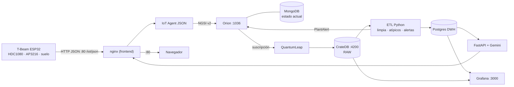

# AgroIoT · AgroSense — Monitoreo IoT de cultivos sobre FIWARE

Plataforma IoT para monitorear plantas. Un **LilyGO T-Beam (ESP32)** mide la temperatura y la humedad del aire (HDC1080), la luz (AP3216) y la humedad del suelo (sensor analógico), y envía los datos a una **EC2 de AWS**. Allí corre, con Docker Compose, toda la cadena FIWARE → histórico crudo → ETL → DWH → API con IA (Gemini) → panel web.



| Capa | Servicio (contenedor) | Qué hace |
|---|---|---|
| Ingesta | `iot-agent` | Traduce el JSON del sensor a una entidad NGSI (`planta01`, tipo `PlantSensor`) |
| Contexto | `orion` + `db-mongo` | Estado en tiempo real. Puerto público **1036** → 1026 |
| Histórico crudo | `fiware-quantumleap` + `db-crate` | Cada cambio en Orion se guarda como serie de tiempo (`mtopeniot.etplantsensor`). UI en **4200** |
| ETL | `etl` (Python) | Cada 5 min: limpia (rangos físicos), descarta **valores atípicos** de temperatura y humedad (mediana/MAD), genera alertas (sin repetirlas), detecta **sensor sin datos** y calcula resúmenes **horarios y diarios** |
| DWH | `dwh-postgres` | `lectura_limpia`, `resumen_horario`, `resumen_diario`, `alerta`. Solo escucha en `127.0.0.1` |
| API + IA | `api` (FastAPI) | Login, plantas, lecturas, historial, alertas y `/api/chat` con **Gemini** (le pasa las últimas lecturas, el resumen de 24 h y 7 días, y las alertas) |
| Presentación | `frontend` (React + nginx) | Panel en **:80**. También recibe al sensor en `/iot/json` |
| Admin | `grafana` | Dashboards técnicos ya provisionados (DWH + Crate) en **:3000** |

---

## ✋ Lo que tienes que hacer a mano (checklist)

> [!IMPORTANT]
> Todo lo demás lo hacen los scripts. Estos son los únicos pasos manuales.

| # | Qué | Dónde / cómo |
|---|---|---|
| 1 | **Crear tu repositorio en GitHub** (privado, sin README) y subir este código | Ver [Paso 1](#paso-1--tu-repositorio-en-github) |
| 2 | **Revisar el Security Group** de la EC2: 22, 80, 1036, 4200, 3000 | Consola AWS → EC2 → tu instancia → *Security* → *Security groups* → *Edit inbound rules* |
| 3 | **Desplegar** (un solo comando desde tu PC) | `.\deploy\desplegar.ps1` (ver [Paso 3](#paso-3--desplegar-en-la-ec2)) |
| 4 | **Poner tu API key de Gemini** en el servidor | `nano ~/agroiot/.env` → `GEMINI_API_KEY=...` → `sudo docker compose up -d api` |
| 5 | **Crear `secrets.h` del firmware** con tu WiFi y la `IOTA_APIKEY` | `firmware/IoT_Orion/include/secrets.example.h` → copiar como `secrets.h` |
| 6 | **Calibrar el sensor de suelo** (opcional, recomendado) | `HUMEDAD_RAW_SECO` / `HUMEDAD_RAW_MOJADO` en `firmware/IoT_Orion/src/main.cpp` |
| 7 | **Si la IP pública cambia** (detener/iniciar la EC2) | Actualizar `-Ip` al desplegar, `PUBLIC_HOST` en `~/agroiot/.env` y `SERVER_HOST` en `secrets.h` (volver a flashear) |

---

## Paso 1 — Tu repositorio en GitHub

Este repo ya está inicializado localmente (`C:\Users\Usuario\Desktop\AgroIoT`) con un primer commit, y **no está conectado al repo de tu compañero**.

1. En GitHub: **New repository** → nombre `AgroIoT` → **Private** → *no* agregues README, .gitignore ni licencia → **Create**.
2. En PowerShell:
   ```powershell
   cd C:\Users\Usuario\Desktop\AgroIoT
   git remote add origin https://github.com/TU_USUARIO/AgroIoT.git   # <-- CAMBIAR TU_USUARIO
   git push -u origin main
   ```
3. Para trabajar como único colaborador, deja el repo **privado** y no agregues a nadie en *Settings → Collaborators*.

> [!NOTE]
> El despliegue **no necesita GitHub**: `desplegar.ps1` sube el código directo por `scp`. GitHub sirve como respaldo e historial.

## Paso 2 — Security Group

| Puerto | Origen | Para qué |
|---|---|---|
| 22 | Tu IP (`Mi IP`) | SSH / despliegue |
| 80 | `0.0.0.0/0` | Panel web, API y **entrada del sensor** (`/iot/json`) |
| 1036 | `0.0.0.0/0` | Orion (NGSI v2) |
| 4200 | Tu IP | CrateDB Admin UI |
| 3000 | Tu IP | Grafana |
| 7896 | — | *Opcional:* solo si quieres que el sensor hable directo con el agente IoT |

> [!TIP]
> El sensor publica por el **puerto 80** (nginx lo reenvía al agente IoT). Así no hace falta abrir el 7896.

## Paso 3 — Desplegar en la EC2

Desde tu PC, en PowerShell (la primera vez tarda entre 5 y 10 minutos):

```powershell
cd C:\Users\Usuario\Desktop\AgroIoT
.\deploy\desplegar.ps1
# si la IP cambió:   .\deploy\desplegar.ps1 -Ip 1.2.3.4
```

> [!TIP]
> Si PowerShell bloquea el script: `powershell -ExecutionPolicy Bypass -File .\deploy\desplegar.ps1`

El script:
1. Empaqueta el último commit (`git archive`). Nunca incluye `.env`, `.pem` ni `secrets.h`.
2. Lo sube con tu llave `C:\Users\Usuario\Downloads\llaves_servidor_final.pem` a `~/agroiot` de `ubuntu@3.95.254.224`.
3. Ejecuta [`scripts/setup_ec2.sh`](scripts/setup_ec2.sh), que:
   - instala Docker si falta y aplica `vm.max_map_count` (lo exige CrateDB),
   - **detiene el despliegue viejo de `~/proyecto`** (sus volúmenes **no** se borran),
   - crea `~/agroiot/.env` con **claves aleatorias** (solo la primera vez),
   - levanta CrateDB, crea el usuario `iot`, levanta todo y aprovisiona el agente IoT y la suscripción,
   - **imprime al final** la clave del panel, la `IOTA_APIKEY` y la IP para el firmware.

<details>
<summary>Alternativa manual (sin el script de PowerShell)</summary>

```powershell
# desde tu PC (PowerShell), en la carpeta del repo
git archive --format=tar.gz -o agroiot.tar.gz HEAD
scp -i C:\Users\Usuario\Downloads\llaves_servidor_final.pem agroiot.tar.gz ubuntu@3.95.254.224:~/
ssh -i C:\Users\Usuario\Downloads\llaves_servidor_final.pem ubuntu@3.95.254.224
```
```bash
# ya dentro de la EC2
mkdir -p ~/agroiot && tar -xzf ~/agroiot.tar.gz -C ~/agroiot && cd ~/agroiot
sudo bash scripts/setup_ec2.sh
```
</details>

## Paso 4 — Gemini

1. Crea la clave en <https://aistudio.google.com/apikey>.
2. En la EC2:
   ```bash
   cd ~/agroiot
   nano .env                      # GEMINI_API_KEY=tu_clave   (GEMINI_MODEL=gemini-3.8-flash)
   sudo docker compose up -d api  # recrea la API con la nueva clave
   ```
3. En el panel, la tarjeta **Servicios → IA Gemini** debe pasar a **OK**.

## Paso 5 — Firmware (T-Beam)

1. Copia `firmware/IoT_Orion/include/secrets.example.h` como **`secrets.h`** (misma carpeta) y completa:

   | Constante | Valor |
   |---|---|
   | `WIFI_SSID` / `WIFI_PASSWORD` | Tu red WiFi de 2.4 GHz |
   | `SERVER_HOST` | `3.95.254.224` (o la IP actual) |
   | `SERVER_PORT` | `80` |
   | `IOTA_APIKEY` | La que imprimió `setup_ec2.sh` (o `grep IOTA_APIKEY ~/agroiot/.env`) |
   | `DEVICE_ID` | `planta01` |
2. Abre `firmware/IoT_Orion` con PlatformIO → **Upload** → **Monitor**: debe aparecer `[HTTP] Respuesta servidor: 200 (OK)`.

> [!NOTE]
> Si el HDC1080 no responde, el firmware envía `-999` y el ETL genera una alerta de **error de sensor**: así se ven los fallos del hardware en el panel.

---

## Verificar que todo funciona

En la EC2 (`cd ~/agroiot`):

| Prueba | Comando / URL |
|---|---|
| **Verificación completa** (contenedores, Orion, Crate, DWH, API, IA, Grafana) | `bash scripts/verificar.sh` |
| Estado de contenedores | `sudo docker compose ps` |
| Simular el sensor sin el ESP32 | `bash scripts/probar_sensor.sh` · con suelo seco: `bash scripts/probar_sensor.sh 27 55 12000 12` |
| Entidad en Orion | `curl -s localhost:1036/v2/entities -H 'fiware-service: openiot' -H 'fiware-servicepath: /'` |
| Dato crudo en Crate | `http://3.95.254.224:4200` → usuario `iot` → `SELECT * FROM mtopeniot.etplantsensor ORDER BY time_index DESC LIMIT 20;` |
| ETL | `sudo docker logs -f etl` → `ETL ok: N lecturas, M alertas nuevas` |
| Panel | `http://3.95.254.224` (usuario `admin`, clave `FRONT_PASSWORD` del `.env`) |
| Grafana | `http://3.95.254.224:3000` → carpeta **AgroIoT** → *AgroIoT - Sensores* |
| API (Swagger) | `http://3.95.254.224/api/docs` |

## Operación diaria

| Quiero… | Cómo |
|---|---|
| Actualizar el código | `git commit` en tu PC y luego `.\deploy\desplegar.ps1` (conserva `.env` y los datos) |
| Ver las claves | `cat ~/agroiot/.env` en la EC2 |
| Reiniciar un servicio | `sudo docker compose restart api` (o `etl`, `frontend`…) |
| Ver logs | `sudo docker compose logs -f --tail 100 <servicio>` |
| Conectar DBeaver/DataGrip al DWH | Túnel SSH a la EC2 → host `127.0.0.1`, puerto `5432`, usuario `dwh`, base `plantas`, clave `DWH_PASSWORD` |
| Ajustar umbrales del cultivo | `VALID`/`WARN` en `app/etl/etl.py` **y** `app/frontend/src/lib/umbrales.js` |

## Estructura

```
app/
  api_ai/     FastAPI (main.py) + cliente Gemini Interactions API (ia.py)
  dwh/        Esquema Postgres (init.sql)
  etl/        ETL Python (Crate -> limpiar -> atípicos -> alertas -> DWH + Orion)
  frontend/   React 19 + Tailwind 4 + Recharts (build -> nginx). Proxy /api y /iot
deploy/       desplegar.ps1 (Windows -> EC2)
firmware/     PlatformIO ttgo-t-beam (secrets.example.h -> secrets.h)
grafana/      Datasources y dashboard provisionados
scripts/      setup_ec2.sh, generar_env.sh, crate_auth.sh, provisionar.sh, probar_sensor.sh
docker-compose.yml
```

## Contrato con el sensor

`POST http://<IP>/iot/json?k=<IOTA_APIKEY>&i=planta01`

```json
{"temperatura_aire": 24.5, "humedad_aire": 60, "luz_lux": 15000,
 "humedad_suelo_pct": 45, "humedad_suelo_raw": 2100, "alerta_seco": false}
```

En Orion quedan como `temperature`, `humidity`, `luminosity`, `soilMoisture`, `soilMoistureRaw` y `dryAlert` (mapeo en `scripts/provisionar.sh`).
